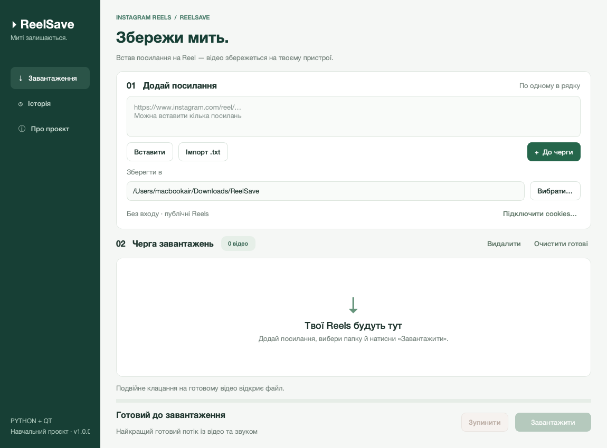

# ReelSave

Кросплатформний настільний застосунок для завантаження Instagram Reels.

**Python 3.11+ · PySide6 / Qt · yt-dlp · SQLite**



## Можливості

- Українськомовний графічний інтерфейс: завантаження, історія, довідка.
- Одне посилання або черга Reels; вставлення з буфера обміну та імпорт `.txt` у UTF-8.
- Перевірка адрес до звернення до мережі та видалення повторів у черзі.
- Вибір папки; прогрес, швидкість і приблизний час до завершення.
- Послідовне фонове завантаження: вікно залишається доступним для взаємодії.
- Зупинка черги, повтор невдалих і зупинених завантажень.
- Історія в SQLite між запусками, відкриття файлу або папки з історії.
- Пропуск файлів, уже завантажених у вибрану папку. Видалені файли можна завантажити знову.
- Необов’язковий файл cookies для контенту, доступного обліковому запису.
- Додатковий консольний інтерфейс для автоматизації.

Підтримуються посилання `https://www.instagram.com/reel/КОД/` та `/reels/КОД/`,
зокрема з параметрами `?igsh=…`. Посилання на профіль, Stories, звичайні дописи
та скорочені `/share/…` не підтримуються: відкрий таку адресу в браузері
й скопіюй пряме посилання на Reel.

## Швидкий запуск

Потрібен установлений **Python 3.11 або новіший** із `pip` та `venv`.
Для першого встановлення потрібен інтернет. Окремий FFmpeg не потрібен.

- **Windows:** запусти `start_windows.bat` подвійним клацанням. Python Launcher `py`
  встановлюється стандартним інсталятором Python.
- **macOS:** запусти `start_macos.command`; якщо система не дозволяє відкрити файл,
  відкрий Термінал у папці проєкту й виконай `bash start.sh`.
- **Linux:** відкрий термінал у папці проєкту й виконай `bash start.sh`.

Скрипти створюють локальне середовище `.venv` та встановлюють залежності, якщо їх ще немає.
Віртуальне середовище не переноситься між комп’ютерами — його потрібно створити заново.

### Встановлення вручну: Windows (PowerShell)

```powershell
py -3 -m venv .venv
.venv\Scripts\python.exe -m pip install -r requirements.txt
.venv\Scripts\python.exe main.py
```

### Встановлення вручну: macOS / Linux

```bash
python3 -m venv .venv
.venv/bin/python -m pip install -r requirements.txt
.venv/bin/python main.py
```

На Ubuntu/Debian, якщо немає `venv`: `sudo apt install python3-venv`.
У разі помилки Qt `xcb` можуть знадобитися системні бібліотеки
`libxcb-cursor0`, `libegl1`, `libopengl0` (пакети залежать від дистрибутива).
Для GUI потрібен графічний сеанс; на сервері без робочого столу використовуй CLI.
Підтримка версії ОС залежить від установленої версії PySide6:
наприклад, перевірений тут пакет PySide6 6.11.2 для macOS потребує macOS 13+.

## Як завантажити відео

1. В Instagram вибери «Поділитися → Копіювати посилання» біля потрібного Reel.
2. Встав посилання в застосунок або імпортуй `.txt` із посиланнями.
3. Натисни **«До черги»**. Якщо є некоректні посилання, виправ їх: усі посилання
   додаються лише після успішної перевірки всього набору.
4. Вибери папку й натисни **«Завантажити»**.
5. Подвійне клацання на готовому рядку відкриває відео.

Кнопка «Завантажити» також повторює невдалі та зупинені завантаження.
Після зупинки ще не розпочаті завдання залишаються в черзі. Частковий `.part`-файл
зберігається, і yt-dlp спробує продовжити його завантаження під час повторної спроби,
якщо сервер це підтримує. Зупинка спрацьовує під час наступної події завантажувача;
очікування відповіді на мережевий запит і повторних спроб може тривати десятки секунд.
Під час закриття вікна застосунок спочатку запитує зупинку й чекає завершення потоку.

«Видалити» та «Очистити готові» змінюють лише чергу й не видаляють відео з диска.
Якщо готовий файл видалено або потрібна копія в іншій папці, прибери рядок із черги
та додай посилання знову. Черга зберігається до закриття застосунку; історія та папка
призначення — між запусками. Статуси зі старої російськомовної історії автоматично
оновлюються українською, зі збереженням перевірки вже завантажених файлів.

### Якість

Вибирається `format="best"`: найкращий доступний **єдиний потік із відео та звуком**.
Він зберігається без перекодування, зазвичай у MP4. Окремі доріжки не об’єднуються,
тому якість може відрізнятися від максимальної серед усіх окремих форматів.
Це дозволяє обійтися без зовнішнього FFmpeg і спростити запуск на різних ОС.

### Якщо Instagram вимагає входу

У застосунку натисни **«Підключити cookies…»** та вибери файл cookies у форматі
Mozilla/Netscape, експортований зі свого браузерного сеансу Instagram.
Застосунок не приймає пароль і не обходить обмеження доступу.
Cookies — необов’язкове налаштування; публічні відео теж іноді вимагають входу.

Як варіант, yt-dlp уміє експортувати cookies браузера:

```bash
python -m yt_dlp --cookies-from-browser firefox --cookies cookies.txt --skip-download "https://www.instagram.com/reel/КОД/"
```

Тут `python` — Python віртуального середовища; на macOS/Linux без активації заміни
його на `.venv/bin/python`, на Windows — на `.venv\Scripts\python.exe`.
Потрібен активний сеанс Instagram у Firefox. Експорт може містити cookies
інших сайтів цього профілю. Не публікуй і не пересилай цей файл; видали його,
коли він більше не потрібен. Вміст і шлях до cookies не зберігаються в БД та налаштуваннях
ReelSave; сам yt-dlp може оновлювати вибраний файл cookies під час роботи.

Офіційна довідка: [yt-dlp: cookies](https://github.com/yt-dlp/yt-dlp/wiki/FAQ#how-do-i-pass-cookies-to-yt-dlp).

## Консольний режим

Після встановлення залежностей, із папки проєкту:

```bash
python -m reelsave.cli "https://www.instagram.com/reel/КОД/" -o ./downloads
python -m reelsave.cli --file links.txt --cookies cookies.txt -o ./downloads
python -m reelsave.cli --help
```

Щоб команди були доступні з будь-якої папки, можна встановити сам проєкт:

```bash
python -m pip install .
reelsave
reelsave-cli --help
```

Коди завершення CLI: `0` — усі завантаження успішні або пропущені; `1` — помилка
завантаження; `2` — помилка аргументів; `130` — переривання з клавіатури.

## Структура проєкту

```text
main.py                  запуск GUI
reelsave/
  app.py                 створення застосунку Qt
  gui.py                 вікно й обробники дій користувача
  theme.py               оформлення інтерфейсу
  qt_runtime.py          підготовка атрибутів плагінів Qt на macOS
  models.py              dataclass і перелік статусів
  urls.py                перевірка та нормалізація URL
  downloader.py          сервіс на базі yt-dlp, не залежить від Qt
  worker.py              черга в QThread, сигнали та зупинка
  storage.py             історія SQLite та налаштування JSON
  cli.py                 консольний інтерфейс
tests/                   модульні, GUI- та HTTP-тести
docs/interface.png       знімок інтерфейсу
examples/links.txt       приклад списку посилань
.github/workflows/       автоматична перевірка на трьох ОС
start*                   скрипти запуску для Windows, macOS і Linux
```


## Зберігання даних

| ОС | Папка налаштувань та історії |
| --- | --- |
| Windows | `%LOCALAPPDATA%\ReelSave` |
| macOS | `~/Library/Application Support/ReelSave` |
| Linux | `$XDG_DATA_HOME/reelsave` або `~/.local/share/reelsave` |

Усередині розташовані `settings.json` та `history.sqlite3`. Відео за замовчуванням
зберігаються в `~/Downloads/ReelSave`; папку можна змінити. База містить історію всіх
операцій, а інтерфейс показує останні 300. Для тестів або переносимого зберігання
можна задати змінну середовища `REELSAVE_DATA_DIR`.

## Тести

```bash
python -m pip install -e ".[dev]"
python -m pytest -q
```

Тести не використовують обліковий запис Instagram і не звертаються до зовнішніх сайтів.
GUI працює через Qt `offscreen`. Інтеграційний тест запускає тимчасовий HTTP-сервер
лише на `127.0.0.1`, перевіряє реальне передавання байтів через yt-dlp, прогрес
і розпізнавання вже завантаженого файлу. Доступність самого Instagram це не доводить.
GitHub Actions містить матрицю Windows/macOS/Linux; вона виконається після публікації
репозиторію.

## Збирання окремого застосунку (необов’язково)

```bash
python -m pip install -e ".[build]"
python -m PyInstaller --noconfirm --windowed --name ReelSave --collect-all yt_dlp main.py
```

Результат з’явиться в `dist/`. Збирання потрібно виконувати окремо на цільовій ОС:
Windows — для Windows, macOS — для macOS, Linux — для Linux.
Це необов’язкове збирання не входить до виконаної локальної перевірки.

## Якщо відео більше не завантажуються

Instagram змінює способи доступу. Онови завантажувач у віртуальному середовищі:

```bash
python -m pip install --upgrade yt-dlp
```

- **Потрібен вхід / login required:** підключи чинний файл cookies.
- **429 / rate limit:** зачекай, не запускай багато повторів поспіль.
- **Видалений або закритий ролик:** перевір доступ у своєму браузері.
- **Помилка запису:** вибери доступну папку та перевір вільне місце.
- **Немає відповіді:** перевір з’єднання й повтори спробу пізніше.

Для демонстрації краще заздалегідь перевірити доступний тобі Reel та підготувати cookies,
якщо Instagram вимагає входу. Застосунок не гарантує завантаження будь-якого ролика.
Завантажуй власний контент або матеріали, на завантаження яких маєш дозвіл.

## Документація бібліотек

- [Qt for Python](https://doc.qt.io/qtforpython-6/)
- [QThread і сигнали](https://doc.qt.io/qtforpython-6/PySide6/QtCore/QThread.html)
- [Вбудовування yt-dlp](https://github.com/yt-dlp/yt-dlp#embedding-yt-dlp)
- [sqlite3 у Python](https://docs.python.org/3/library/sqlite3.html)
